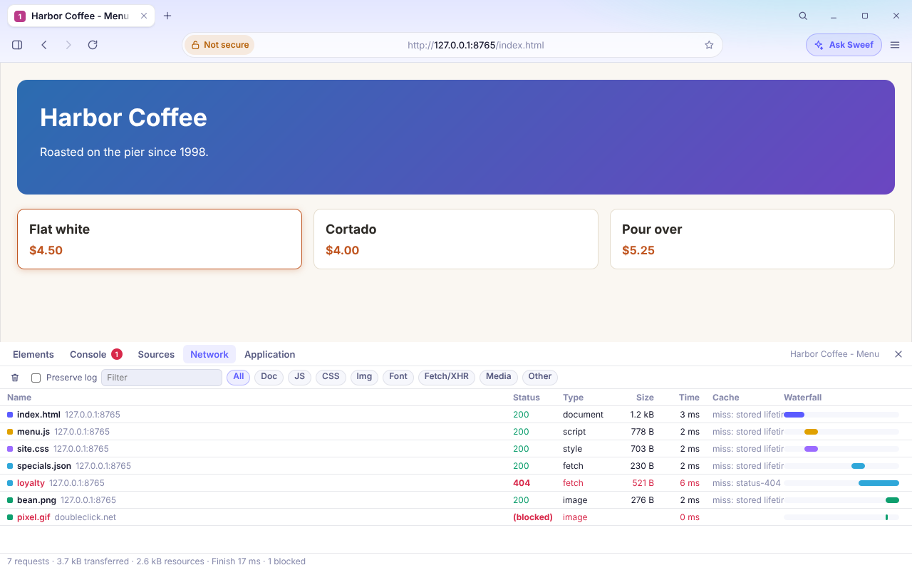
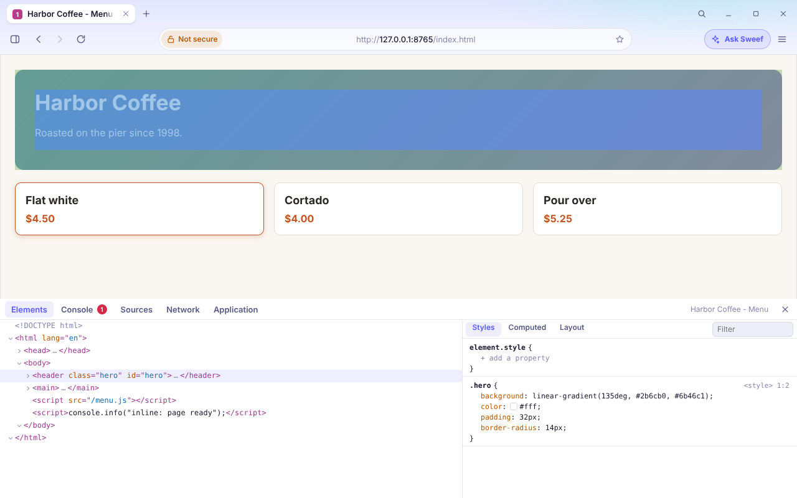

# Developer Tools

Sweef has an "Inspect": Developer Tools v1, a panel docked under the page with a Console, a Network log, an Elements
view with the CSS that applies, a Sources viewer and a small Application view. It is for debugging why a page
loads wrong in Sweef: what failed, what was blocked, what the DOM and the styles really are.

<table>
  <tr>
    <td width="50%"></td>
    <td width="50%"></td>
  </tr>
  <tr>
    <td colspan="2">Real headless runs against a local page (<code>sweef gui --headless --script</code>, Linux). The previews of the panels in the light and dark themes are <code>design/devtools-*.png</code> (<code>go run ./internal/ui/cmd/uipreview -only devtools</code>), drawn from fixed fixtures.</td>
  </tr>
</table>

## Open it

| How | |
|---|---|
| `F12`, `Ctrl+Shift+I` (`Cmd+Opt+I` on macOS) | toggles the panel for the active tab |
| `Ctrl+Shift+J` | opens it on the Console |
| `Ctrl+Shift+C` | opens it on Elements (there is no click-to-pick mode yet) |
| Menu, **More tools**, **Developer tools** | |
| Command palette (`Ctrl+K`), "Developer tools" | |
| "Inspect" in a page context menu | not built here: it calls `a.openDevTools(tabID)` or `a.openDevToolsAt(tabID, x, y)` (below) |

The panel is bound to the active tab and follows tab switches. Drag its top edge (or use the arrow keys on it;
double click resets) to resize it; the height is the setting `devtools.height` (160 to 1200 px, default 320), and the
panel last used is `devtools.panel`. Closing it gives the page its space back.

## Which approach: docked, inside the chrome page

The first idea was an internal page tab (`sweef://devtools?tab=<id>`). It would have been simple, but it cannot do
what Elements needs: highlight the selected node on the page you are looking at, because the page is hidden while
the devtools tab is in front. So the panel is **docked**, and docking turned out not to be invasive:

* The chrome page already owns the layout and reports the hole the page is shown in. `#main` now holds a `#stage`
  column: `#viewport` (flex 1) above `#devtools` (fixed height). Opening the panel shrinks the hole, the app sees the
  new `layout` message and resizes the page with the normal path; nothing in the compositor changed.
* The panel code, `chrome/devtools.js` and `.css` (about 54 KB and 14 KB), is **lazy**: it is parsed the first time
  the panel opens, so the chrome's eager set only grew by the menu entry and the loader (1.8 KB).
* The highlight is drawn by the engine into the page's own display list (`Tab.DevHighlight`), never into the
  document, so it cannot be seen or changed by page script and goes away when the panel closes or the tab changes.

## The panels

**Console.** `console.*` output and uncaught errors, live. Level chips (All, Errors, Warnings, Logs), a text filter,
clear (it hides what was shown; the tab's log, which `sweef console` reads, is untouched), identical consecutive
lines folded with a count, the error and warning counts on the tab. Errors show their stack. A message carries the
`file:line` it came from when the engine knows it: a `console.*` call made while a script's top level runs, and an
error thrown at the top level of a script, both give `script URL:line:col` (click it to open that line in Sources).
Calls made later from a timer or a `fetch` callback have no location (QuickJS names every script `<eval>`; the stack
text still shows the function names and `in <script>`). The prompt at the bottom evaluates in the page as a global
script (`var` sticks), prints the value (objects and arrays summarised, DOM nodes as `<div#id.class>`, promises
awaited, errors with their stack) and keeps a history (Up and Down).

**Network.** One row per request the page makes through the engine: the document, scripts, styles, images, fonts,
`fetch`/XHR, media (answers of a service worker are listed too, with `service worker` in the cache column; no test covers that). Columns: name, status, type, size (transferred, or
`(cache)`), time, the cache outcome (the same `x-sweef-cache` value the agent CLI shows: `hit`, `revalidated`,
`miss: no-store`, ...) and a waterfall. Filter by text and by type; **Preserve log** keeps earlier navigations
(otherwise only the current one is shown, as in Chrome). A request the tracker blocker refused is shown in red as
`(blocked)` with the reason and the host; failed ones as `(failed)` with the error; unfinished ones as `(pending)`.
Click a row: **Headers** (general, response and request headers, the request payload), **Preview** (JSON
pretty-printed, text, an image) and **Response** (the text, first 60 KB; Copy has all of it).

**Elements.** The DOM tree (expand and collapse with the arrow or the keyboard; text, comments and the doctype
included; a lone short text child shows inline). Selecting a node highlights its margin, border, padding and content
boxes on the page; hovering a row does the same. The right side has **Styles** (the rules that match: the
element's `style` attribute first, then author rules from `<style>` and linked sheets, `@import` included, with the
sheet and line, the `@media` they sit in, and the declarations that lose the cascade struck through), **Computed**
(the engine's computed values) and **Layout** (the box model numbers). Editing: double click an attribute value or a
text node, Enter commits; `Delete` removes the selected node; on `element.style` you can toggle each declaration,
click a value to edit it and add a property. An edit is made with the page's own DOM calls (`setAttribute`,
`removeAttribute`, `data =`, `remove()`, through a hidden `__swDevNode(id)` helper), so MutationObservers and custom
elements see it, and the page repaints; a tab with JavaScript turned off is edited in the tree directly.

**Sources.** The document, scripts and stylesheets of the current page (fetched ones with their size, inline ones
numbered) and a read-only viewer with line numbers. **Pretty print** formats minified JavaScript, CSS and JSON
(a small tokenizer, not a parser: it is for reading, and a regular expression literal in an unusual position can
fool it; it formats the first 400 kB of a file and leaves the rest as it is). Long lines scroll sideways with Shift and the wheel.

**Application.** Cookies the page's URL would send (the `HttpOnly` ones too; it is the person's own browser and the
list never reaches the page), `localStorage` and `sessionStorage`. Read only. IndexedDB and Cache Storage are not
listed yet.

## What is not there

No breakpoints, stepping or call-stack view (QuickJS is driven from Go and has no debugger hook wired); no source
maps; no click-to-pick of an element on the page; no CSS rule editing for stylesheet rules (only `element.style`);
no UA stylesheet rules, pseudo-elements, `@layer` order, CSS nesting or `@container` conditions in Styles (the
`@container` rules are listed whether or not they apply); no forced `:hover` state; no DOM tree drag and drop;
iframe documents are not shown inside the tree; WebSocket frames, request timing breakdown (DNS, connect, TLS) and
throttling are not in the Network panel; the console does not show `console.table` as a table. Network entries and
their bodies exist only for requests made while the engine ran them: reload to see a page's requests with the panel
open (response bodies of text and images are kept only while it is open; documents, scripts and styles always).

## How it works

* **Engine** (`internal/engine`, all on `*Tab`, no new network access):
  `devtools_net.go` is the network recorder (`DevNetwork`, `DevNetUpdates`, `DevNetBody`, `DevSources`,
  `DevSource`, `DevCookies`, `DevNoteBlocked`, `DevAttach`, `DevSignals`) fed from `httpDo` and the document fetch,
  the two places every request goes through; `devtools_dom.go` is Elements (`DevDOMRoot`, `DevDOMChildren`,
  `DevDOMPath`, `DevDOMNode`, `DevStyle`, `DevHighlight`, `DevSetAttr`, `DevRemoveAttr`, `DevSetText`,
  `DevRemoveNode`, `DevNodeAt`) with a small CSS rule scanner and specificity function for the matched rules;
  `devtools_repl.go` is the prompt (`DevEval`) and storage (`DevStorage`). The existing console ring is reused; its
  entries gained an optional `loc`. The uncaught-error log line now starts with the error's name and message (before,
  a listener or timer error logged only its stack).
* **App** (`internal/app/devtools.go`): the binding (which tab), the method table behind `devtools.req`, the pulse,
  and the entry points. Calls run on the inspected tab's worker, like every call that reads page state.
* **UI** (`internal/ui/web/chrome/devtools.js`): one object per panel. The page runs **no timers**: the app looks at
  four counters of the inspected tab every 300 ms while the panel is open and sends `devtools.dirty` only when one
  changed, so an open panel on an idle page costs a counter read. Scrolling is the JS-driven kind the other chrome
  pages use (`shared/scroll.js`, `vlist.js`), because the engine has no native element scrolling. The waterfall is
  drawn inside its cell: a block child with a percentage width inside a flex row made the engine mis-size the row's
  other cells.
* **Go entry points** for other code (UI loop only): `openDevTools(tabID)`, `openDevToolsPanel(tabID, panel)`,
  `openDevToolsAt(tabID, x, y)` (selects the element at a point of the page, CSS px in the viewport: this is what
  a context menu's "Inspect" should call), `toggleDevTools()`, `closeDevTools()`.

## Isolation and cost

* Only the **chrome page** may send `devtools.*` messages (`onUIMessage` checks the sender), and a request can only
  address the tab the panel is bound to, which the app picks from this window's tabs. A web page cannot ask for either.
  Results go to the chrome only. The page's own `__sweefPost` binding is dropped for non-`sweef://` documents as before.
* A tab showing a `sweef://` page (Settings, History) can be looked at but not changed and nothing can be evaluated in
  it: those pages hold the browser's privileges, and a pasted snippet should never run there.
* Private tabs work (the recorder lives with the tab and dies with it); nothing but the panel's height and name is
  stored.
* A fix that came with this work. The app sends state patches to every internal page that said `ui.ready`
  (and `state.devtools` is part of them). A tab that had shown a Sweef page and navigated to a web page stayed on that
  list until its load finished, so a script of the new page could define `window.sweef` and be handed the browser's
  state (tabs, settings, and now the Developer Tools binding). `sendTo` now refuses to evaluate a message in a page tab
  whose URL is not `sweef://` (`TestDevToolsStateNeverReachesWebPages` fails without it).
* Memory: the recorder keeps at most 800 entries per tab. Bodies: documents, scripts and styles up to 1 MB each, 4 MB per
  tab while the panel is closed (the bodies of earlier documents are dropped when a new one starts) and 24 MB while it
  is open (then also text responses and images up to 512 KB, so Preview works). Binary size: +148 KB on the stripped linux/amd64
  release build (37,175,422 to 37,326,974 bytes, measured with `go test ./cmd/sweef -run SizeBudget -v` on this commit and
  on its parent), of which 19 KB are the deflated UI assets.

## Tests

* `internal/engine/devtools_test.go`: the recorder (types, status, headers, cache outcome, blocked entries, body
  budgets, navigation numbers), Sources, the DOM tree and edits, matched rules and the cascade (specificity,
  `!important`, `@media`, inline), computed style and box, the highlight pixels, the prompt, storage and cookies,
  console locations; all against local fixtures.
* `internal/ui/ui_test.go` (`TestDevTools*`) drives the panel code through the real engine with
  `internal/ui/preview/devtools_mock.js` answering as the app would; `uipreview` writes `docs/design/devtools-*.png`.
* `internal/app/devtools_test.go`: F12 and the other shortcuts open it for the active tab and the page makes room, the
  console and prompt with real clicks and typing, the Network panel, highlight and edit reaching the page, isolation.

## Platforms

Verified on Linux (X11 under Xvfb, and the headless shell: `sweef gui --headless --script ...`). **Windows and macOS
are UNVERIFIED at runtime**: the panel is chrome HTML, so it should behave the same, but nobody has pressed F12 there
except through the key map unit tests (`F12` is in the Windows, macOS and X11 key maps). On macOS F12 may be taken by the
system; use `Cmd+Opt+I` or the menu.
